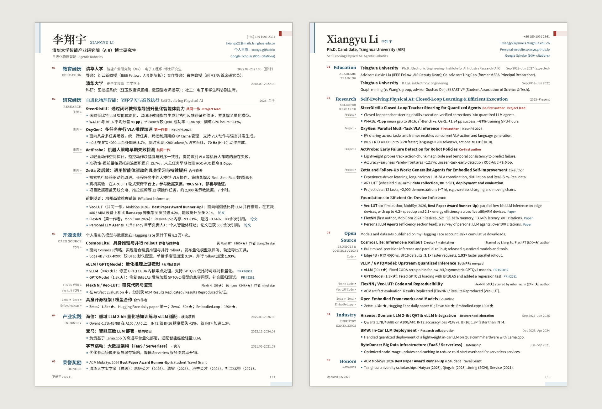

# Xiangyu Li — Resume

A print-first, bilingual academic resume and publication list built with React
and Vite. The website renders true-size A4 pages in the browser and exports the
same layout to PDF with Playwright.

[Live preview](https://xxxxyu.github.io/resume/?locale=zh&edition=complete) ·
[English version](https://xxxxyu.github.io/resume/?locale=en&edition=complete) ·
[Chinese PDF](https://xxxxyu.github.io/resume/downloads/zh/resume.complete.pdf) ·
[English PDF](https://xxxxyu.github.io/resume/downloads/en/resume.complete.pdf) ·
[All PDF builds](https://github.com/xxxxyu/resume/actions/workflows/pages.yml)

> 中文简介：这是我的中英文个人简历源码。网页版、单页 PDF、完整简历和论文列表共用同一套内容与排版。欢迎 fork / clone [GitHub 仓库](https://github.com/xxxxyu/resume) 按需修改。你的 star 对我很重要，多谢！



## What is included

- Chinese and idiomatic English content with a shared layout system.
- Independent language and document-length controls.
- A4-sized browser pages with automatic publication-list pagination.
- An optional high-contrast monochrome palette for black-and-white printing.
- Responsive preview scaling: true-size A4 on large displays and proportional
  fit-to-width scaling on tablets and phones.
- Stacked, preview-only contact and template-reuse notes above the A4 pages.
- Stable Chromium-based PDF and PNG export.
- Local, version-controlled Latin and CJK web fonts—no font CDN or system font
  installation is required.
- Optional synchronization of publications, citations, and links from my
  personal-homepage repository, with explicit overrides for newer measurements.
- GitHub Pages deployment and fresh PDF artifacts from every push to `main`.

## Preview locally

Install Node.js 20 or newer, then run:

```bash
npm install
npm run dev
```

`npm run dev` first refreshes data from my adjacent personal-homepage checkout,
which defaults to `../xxxxyu.github.io`. If you cloned this repository without
that data source, use the committed snapshot instead:

```bash
npm install
npm run dev:cached
```

The available routes are:

```text
?locale=zh&edition=one-page
?locale=zh&edition=complete
?locale=zh&document=publications
?locale=zh&edition=complete&palette=mono
```

Replace `zh` with `en` for the English documents. The toolbar and stacked
introductory notes are preview-only and are omitted automatically when printing
or exporting. On large displays, pages remain at their physical A4 size; on
narrower screens, the complete preview scales down uniformly without changing
the print layout. Color is the default palette; select **B&W** in the toolbar or
add `palette=mono` to use the same layout with high-contrast grayscale colors.
Printing and PDF export preserve the selected palette.

The resume header groups the name and affiliation on the left and contacts in
a right-hand column; the update date sits in the footer. Body text stays at 9pt
with 1.5 line height, 3 mm section gaps, 1.5 mm ordinary entry gaps, and 1.2 mm
research entry gaps.
Typography is centralized in the `:root` tokens in `src/styles/main.css`:
6.5pt fine details, 7pt captions, 8pt metadata, 9pt body, 10pt entry titles,
10.5/11pt English/Chinese section labels, 22pt publication-page titles, and 26pt
names in both languages. Weights use only 400/600/700; tracking uses 0, ±0.5px,
or 1px. Reuse these tokens instead of adding per-entry sizes or arbitrary weights.
The resume uses a 9 mm top margin. In the complete edition, the continuation
hint shares the footer row with the update date and page number.

## Use the design for your own resume

Fork or clone the repository and replace the authored content in:

- `content/zh/resume.json` — Chinese profile, resume sections, and UI labels.
- `content/en/resume.json` — English content and labels.
- `content/metrics.json` — shared, manually confirmed statistics that are newer
  than the synchronized source.
- `src/generated/homepage.json` — synchronized publication and citation snapshot.

Most text changes require no React edits. `profile` controls the name and
contacts, `sections` contains resume entries, `paperGroups` controls publication
grouping, and `paperOverrides` can replace synchronized paper fields by ID.
Keep section `id` values and contact `kind` values stable: layout checks and
the Scholar link use these identifiers, independently of translated labels.

When present, `metrics.citations` overrides the synchronized citation total for
both publication lists. Update its `total` and `asOf` together; remove the object
to resume using the homepage count. Synchronization never rewrites this file.
GitHub star labels are maintained in both language files; prefer stable lower
bounds such as `90k+★`. They are not fetched or appended to links at build time.

For compact named-work summaries, use `title` for the work name, `meta` for the
author/venue annotation (including punctuation), and `text` for the description.
`highlights` selects key evidence within `text` for black bold emphasis;
`accents` selects a few highest-priority spans for red bold emphasis.
`distinctions` selects awards within `meta` for separate bold emphasis.
An entry's `role` accepts either plain text (for supporting roles) or the same
`{ "text": "…", "highlights": ["…"] }` structure (for lead/first-author roles,
project ownership, or merged upstream contributions). Keep only representative
results and hands-on experience bold; supporting metrics and community reach
stay in regular body text. Content accents are currently limited to lead/first-author
roles in the three main research projects, separating ownership from collaboration
at a glance. Other roles and result highlights remain black. Avoid assigning the
same emphasis to every metric, role, or community statistic.
A research group's
`emphasis: "supporting"` gives its heading and result highlights a quieter visual
hierarchy; the content fields describe meaning rather than colors.
Entries can use `recognition` for brief community recognition in the space at
the right of the heading, in smaller body-color text. Keep the heading and
recognition short enough to share one line.
Use `engagement` for the type of industry experience (such as a research
collaboration or internship); it appears beside the title in the body text color.

Margin links share the full left column: short links sit side by side, with
longer groups wrapping into additional rows. Each group stays right-aligned,
anchors near its entry heading, and clears section labels and preceding links.
Only a group that extends past the body content increases the section height.

My synchronization adapter is intentionally kept in the public repository as a
working example. To connect another data source, edit `resume.config.json` and
`scripts/sync-homepage.mjs`; otherwise, maintain `src/generated/homepage.json`
directly and use the `:cached` commands. An AI coding agent can usually perform
the initial content replacement and source adaptation in one pass.

Please remove my personal information and authored resume content before using
the result as your own. Feel free to fork or clone the repository and adapt it
to your needs. Your star means a lot to me—thank you!

## Build and export

Generate self-contained A4 review HTML and screenshots:

```bash
npm run render:review
```

The files in `output/review/` embed the bundled fonts. The renderer verifies
matching layout in direct and sandboxed previews with external requests blocked,
and checks A4 bounds and compact text in screen and print modes using the bundled
fonts. PDF export shares the same layout checks.

To diagnose a viewer that substitutes local fonts, run
`npm run render:review -- --system-font-fallback`. This additionally checks compact
text with the current operating system's fonts. It is opt-in because system font
metrics vary across platforms; exported documents always embed their fonts.

During content drafting, use `npm run render:review -- --content-draft` to show
overflow without clipping it and mark the A4 page bottom. This deliberately
relaxes the page-height check; it does not replace final A4 validation.

A deterministic build uses the committed data snapshot:

```bash
npm run build
```

To synchronize my homepage data before building:

```bash
npm run build:sync
```

Generate the six PDFs and matching full-page PNG previews:

```bash
npm run render
```

For a clone without the personal-homepage data source, use:

```bash
npm run render:cached
```

Artifacts are written under the ignored `output/{zh,en}/` directory. The
renderer waits for bundled fonts, measures publication entries after layout,
validates A4 bounds, and then exports through headless Chromium. Generated PDFs
and full-page PNGs are intentionally not committed; every `main` build uploads
the six PDFs as a 30-day `resume-pdfs` GitHub Actions artifact and publishes
stable copies under the Pages site's `/downloads/{zh,en}/` paths.

The README preview is the one deliberate exception. After an approved,
substantial layout change, regenerate the bilingual first-page montage with:

```bash
npm run render:cached
npm run render:readme-preview
```

The second command requires Poppler's `pdftoppm`. It is not part of the regular
build, render, or deployment workflow, so routine commits do not churn the
checked-in preview image.

## Content and rendering architecture

```text
content/{zh,en}/resume.json   Authored bilingual resume content
content/metrics.json          Shared overrides for newer measurements
src/generated/homepage.json  Committed snapshot of synchronized data
src/data/index.js             Locale and paper-reference resolution
src/documents/                Resume and publication page composition
src/components/               Shared entry and typography components
src/styles/main.css           A4 screen and print layout
src/layout/resume-links.js    Shared responsive margin-link placement
scripts/sync-homepage.mjs     Personal-homepage data adapter
scripts/render-review.mjs     Self-contained HTML review and embedded checks
scripts/render.mjs            Pagination checks and PDF/PNG export
scripts/lib/                  Shared font-loading and layout validation
scripts/render-readme-preview.mjs  Opt-in bilingual README montage
public/fonts/                 Bundled, self-contained web fonts
scripts/update-font-subsets.py  Opt-in CJK and symbol coverage refresh
```

The separation is deliberate: normal wording changes happen in JSON, source
synchronization happens in one adapter, and layout changes stay in React/CSS.

## Deploy to GitHub Pages

The workflow in `.github/workflows/pages.yml` installs locked npm dependencies,
builds the committed content and snapshot with the `/resume/` project base path,
verifies standalone and embedded previews, renders and uploads the PDF artifact,
and deploys `dist`. Deployment does not resync external data: run
`npm run sync:homepage` locally, review the changes, and commit the snapshot when
you want to update publications. The deployed content therefore matches the
reviewed commit.

For a fork:

1. Change `RESUME_BASE_PATH` to `/<your-repository-name>/`.
2. Open **Settings → Pages** and select **GitHub Actions** as the source.
3. Push to `main`.

## Fonts and reproducibility

The repository includes Source Sans 3, Source Serif 4, and Chinese subsets of
Noto Sans SC and Noto Serif SC under `public/fonts/`. Vite copies them into every
production build and rewrites their URLs for the configured Pages base path.
The deployment workflow fails if any expected font is missing.

All renderers share font loading and disable headless Chromium's full font
hinting, keeping fractional glyph widths consistent for A4 line breaks across
macOS and Linux. Failed review checks upload screenshots and font/layout details
as a short-lived `layout-diagnostics` Actions artifact.

When new Chinese characters or symbols are added, refresh the committed subsets
using the original Noto SC variable fonts (see the upstream links in the font
notices). This opt-in maintenance command requires Python with `fonttools[woff]`;
normal builds and deployments use only the committed WOFF2 files:

```bash
python scripts/update-font-subsets.py \
  --sans /path/to/NotoSansSC-VariableFont_wght.ttf \
  --serif /path/to/NotoSerifSC-VariableFont_wght.ttf
npm run render:review
```

The script preserves previous coverage and adds characters required by both
language files and the publication snapshot, including punctuation and star
symbols, so those glyphs do not silently fall back to system fonts.

See [THIRD_PARTY_NOTICES.md](THIRD_PARTY_NOTICES.md) and the bundled
[SIL Open Font License](licenses/OFL-1.1.txt) for attribution and license terms.

## License

The original application code and visual implementation are available under
the [MIT License](licenses/MIT.txt). Personal information and authored resume
content are not included in that grant. See [LICENSE.md](LICENSE.md) for the
exact scope.
